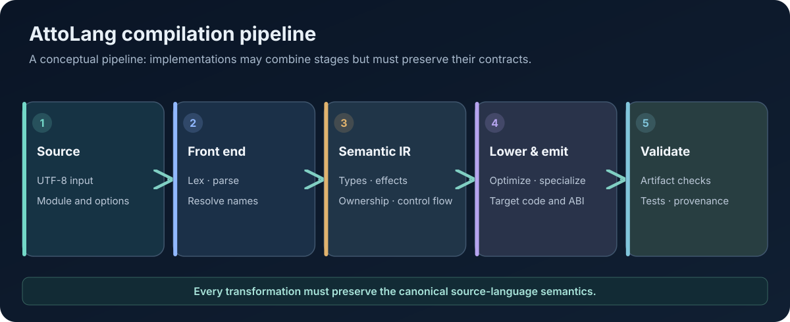

# The AttoLang Compiler: From Source to Executable Programs

**Technical Papers · Paper 02 · Version 0.2 · 8 November 2026**  
**Status:** Architecture overview with a separately identified browser compiler implementation.

<figure class="wp-figure">
  
  <figcaption>Implementations may combine stages, but every stage boundary must preserve its declared invariants. <a href="/whitepapers/assets/02-compiler-pipeline.svg" aria-label="Open full-size SVG diagram for paper 02">Open full-size diagram (SVG)</a></figcaption>
</figure>

## Abstract

A portable language needs a compiler architecture that separates source-language meaning from target-specific code generation. This paper describes the conceptual stages of an AttoLang compiler—from source ingestion and parsing through semantic analysis, intermediate representations, optimization, backend lowering, and artifact validation—and explains why each stage needs explicit contracts.

The current public browser compiler provides a useful concrete example: it is compiled to WebAssembly, accepts a bounded source buffer, emits a separate guest WebAssembly module, and is protected by an ABI and content-integrity checks. That implementation is a documented subset, not proof that every stage or backend described here is already complete.

## 1. Compiler responsibilities

A compiler translates a source program into an executable artifact while preserving the language's defined behavior. For AttoLang, preservation includes more than arithmetic results. It includes type rules, evaluation order, overflow behavior, mutation, ownership, suspension effects, actor boundaries, diagnostics, and any ABI promises made to generated code.

A backend may choose different instructions, calling conventions, memory layouts, or runtime adapters. It may not silently change the language contract.

## 2. Conceptual compilation pipeline

A robust implementation can be organized into the following stages:

1. **Source intake:** validate encoding, source size, module identity, and compilation options.
2. **Lexing and parsing:** turn source text into tokens and a syntax representation; report positioned diagnostics for malformed input.
3. **Name and module resolution:** resolve declarations, visibility, imports, and symbol identities.
4. **Semantic analysis:** validate declarations, expressions, control flow, types, and call resolution.
5. **Effect and ownership analysis:** check suspension, mutation, borrowing, transfer, sharing, and resource lifetimes where those rules are defined.
6. **Intermediate representation:** represent typed operations and control flow in a form suitable for analysis and lowering.
7. **Optimization and specialization:** perform transformations that preserve observable semantics, including overflow and evaluation-order rules.
8. **Backend lowering:** map the canonical representation into target-specific operations, layouts, and ABI calls.
9. **Artifact validation:** verify module structure, imports, exports, memory bounds, and target constraints.
10. **Packaging and provenance:** bind the output to source revision, toolchain, options, artifact digest, and reproducible test evidence.

This is a conceptual architecture. Implementations may combine or subdivide stages, but the contracts between them must remain reviewable.

## 3. Why intermediate representations matter

A syntax tree records how a program was written. It is convenient for diagnostics and syntax-directed checks, but not always suitable for optimization or backend code generation.

A typed high-level representation can make resolved symbols, inferred types, and language constructs explicit. A lower-level control-flow representation can make branches, ownership transfers, cleanup paths, and suspension points easier to analyze. A backend representation can then encode the constraints of a particular machine or virtual machine.

The names AST, HIR, MIR, and backend IR are useful vocabulary, but the existence of an IR with a particular name does not prove it contains the required invariants. The specification should define what information each representation must preserve and which pass is responsible for validating it.

Examples of invariants include:

- Every expression has a resolved type or a diagnostic.
- Every control-flow path obeys return requirements.
- Every ownership transfer has a statically valid source and destination.
- Every suspension point is permitted by the enclosing effect contract.
- Every generated call follows a declared ABI.
- Every optimization preserves checked arithmetic and specified evaluation order.

## 4. Diagnostics are part of the compiler contract

A fail-closed compiler does not emit an artifact for a rejected program. Diagnostics should include stable machine-readable codes, source positions, and a human-readable explanation. Tests should assert both acceptance/rejection and diagnostic properties.

Adversarial input is essential. Deep nesting, extremely long operator chains, malformed encodings, huge declarations, and boundary-sized literals can expose compiler crashes or resource exhaustion. Resource limits should produce controlled diagnostics rather than traps or partial artifacts.

## 5. A concrete implementation: the browser/Wasm path

The public playground uses a Rust compiler compiled for `wasm32-unknown-unknown`. The compiler itself runs locally in the browser. No server receives user source for compilation, and JavaScript does not evaluate the source program.

The published contract records:

- Compiler ABI version 2.
- A 64 KiB UTF-8 input capacity.
- A compiler memory cap of 64 MiB.
- A separate guest module with a bounded import allowlist.
- A source-revision and artifact-digest receipt.
- Fail-closed diagnostics and output bounds.

The compiler artifact is pinned by SHA-256 and verified before use. This protects against running a stale or changed compiler binary under an expected identity. The compiler worker is disposable after a trap because the compiler instance's state may no longer be valid.

See the [compiler contract](../play/docs/COMPILER_CONTRACT.md) and [compiler provenance receipt](../play/public/atto_compiler.receipt.json).

## 6. Compiler ABI versus guest ABI

The compiler ABI is the interface between the browser host and the compiler module: input buffer, compile entry point, output buffer, diagnostics, and version. The guest ABI is the interface between a generated program and its runtime host: entry point, imports, exports, memory, and panic reporting.

Keeping these contracts separate is important. A compiler may be updated without changing the guest ABI, or a guest runtime may evolve while preserving the compiler's public interface. Each version transition needs explicit compatibility rules and tests.

In the browser implementation, guest imports are restricted to a small `atto` module allowlist. Programs using actors receive only the additional actor capabilities documented in the contract. The guest cannot request arbitrary browser APIs through imports.

## 7. Backend-neutral semantics and backend-specific lowering

Backend-neutral phases should decide what the program means. Backend-specific phases should decide how to realize that meaning on the target.

For example, checked signed 64-bit arithmetic must have a consistent overflow outcome even if one target uses a hardware overflow flag and another inserts explicit checks. Actor mail ordering must follow the specified contract even if one runtime uses message queues and another uses worker messages.

A backend adapter should expose a narrow set of primitives. It should not duplicate language semantics in host code. Otherwise, Java, LLVM, .NET, WebAssembly, and Cranelift implementations can drift.

## 8. Testing the compiler

A credible compiler test strategy combines:

- Parser and semantic unit tests.
- Positive and negative source fixtures.
- Boundary tests for resource limits.
- Adversarial and fuzz-generated source.
- Differential tests against a reference implementation.
- Generated artifact validation.
- Guest execution tests.
- Cross-backend comparison of observable outputs and failures.
- Exact-head CI receipts showing non-zero executed steps.

Host-only tests validate host code. They do not prove that compiled guest code executes correctly. A CI run with no executed steps is runner-admission evidence only, not compiler test evidence.

## 9. Reproducibility and provenance

Every published artifact should identify its source commit, source tree, toolchain, target triple, build options, ABI versions, and cryptographic digest. The test receipts should refer to the exact source head that produced the artifact.

A digest proves byte identity, not correctness. Correctness requires a validated build and tests against the intended semantics. A successful workflow on a different head is not evidence for the candidate being reviewed.

## 10. Current status and limitations

The browser compiler is a concrete, published implementation of a bounded subset. Its contract lists accepted syntax and explicitly rejected features; the public examples and browser tests cover only that subset. It does not establish that all compiler stages described in this paper exist in every backend, nor that all targets have equivalent execution support.

The full portable compiler architecture remains a conformance objective. Claims about a particular IR, optimizer, ownership pass, native code generator, or backend should be backed by source inspection and executed tests for that exact implementation.

## Conclusion

A compiler is a chain of semantic obligations. Every transformation must preserve the language contract, every target adapter must implement the same behavior, and every published artifact must be traceable to an exact build. Intermediate representations and a strict compiler/guest ABI boundary make those obligations easier to state, test, and audit.

## References

- [Public compiler contract](../play/docs/COMPILER_CONTRACT.md)
- [Compiler artifact provenance](../play/public/atto_compiler.receipt.json)
- [Playground examples](../play/examples/)
