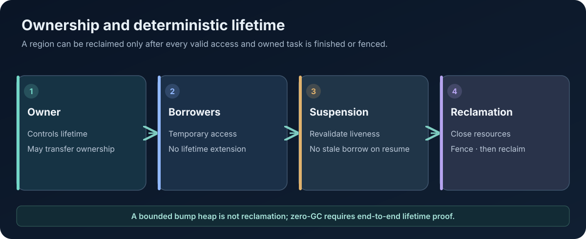

# Memory Ownership, Actor Heaps, and the Path to Zero-GC Execution

**Technical Papers · Paper 03 · Version 0.2 · 8 November 2026**  
**Status:** Design and research paper. Zero-GC execution is a goal; it is not claimed as a completed property of all AttoLang programs.

<figure class="wp-figure">
  
  <figcaption>Bounded allocation alone does not demonstrate deterministic reclamation. <a href="/whitepapers/assets/03-memory-ownership.svg" aria-label="Open full-size SVG diagram for paper 03">Open full-size diagram (SVG)</a></figcaption>
</figure>

## Abstract

Predictable memory behavior requires an explicit account of who owns each allocation, which aliases may access it, how long references remain valid, and what event reclaims the storage. AttoLang's architectural direction is to make ownership and resource lifetime part of the language and runtime contract so that programs can be compiled ahead of time without requiring a tracing garbage collector.

This paper explains the concepts needed for that model, the role actor-owned memory regions can play, and the difficult cases that must be solved before zero-GC execution can be claimed. It also documents an important current limitation: the public browser subset uses a fixed bump-allocated object heap that does not reclaim individual objects.

## 1. What zero-GC means

"Zero-GC" should be used precisely. It does not mean that a program performs no allocation, that memory usage is automatically bounded, or that an operating system and host runtime contain no memory management.

In this paper, zero-GC means that the program's object lifetimes can be managed without depending on a tracing garbage collector to discover unreachable objects. Allocation and reclamation follow explicit ownership, region, or other deterministic lifetime rules.

This property must be assessed at the relevant execution boundary. A native guest may avoid a tracing collector even if the compiler process, host application, or surrounding managed runtime uses one.

## 2. Ownership and borrowing

An ownership system assigns responsibility for a resource. The owner controls its lifetime and may transfer that responsibility under defined rules. Borrowing permits temporary access without transferring ownership. Sharing permits multiple parties to access a value under a defined synchronization and lifetime discipline.

The design vocabulary used by AttoLang includes:

- `rt take`: transfer ownership into a new context.
- `rt borrow`: grant temporary access under a borrow contract.
- `rt share`: use an explicitly shared ownership form.
- `rt copy`: make a copy where the type and operation permit it.

These operations need normative rules for aliasing, lifetime, mutability, failure, and interaction with asynchronous suspension. The spelling alone is not a proof of safety. A compiler must reject invalid uses and the runtime must enforce any remaining dynamic boundary checks.

## 3. Binding mutability is not object ownership

A binding that cannot be reassigned does not necessarily point to immutable storage. Similarly, a mutable binding does not grant unrestricted mutation of every object reachable through it.

The language therefore needs separate rules for:

1. Whether the name may be rebound.
2. Whether the referent may be mutated.
3. Whether the current context has exclusive or shared access.
4. Whether ownership can be transferred.
5. Whether a borrow may remain live across a suspension point.

Keeping these concepts separate prevents a common source of confusion in concurrent programs.

## 4. Actor-owned regions

An actor can provide a useful ownership boundary because its state is accessed through message handling rather than arbitrary shared references. An actor-owned heap or region can group allocations whose lifetime is tied to the actor or to a supervised generation of that actor.

A region-based design must specify:

- Which allocations belong to the actor region.
- Whether references can escape the actor.
- Which values may be sent in messages.
- How external resources are represented and closed.
- What happens to pending tasks and borrows during termination.
- Whether restart creates a new region generation.
- How stale references are fenced from reclaimed storage.
- How quotas and exhaustion are reported.

An actor boundary does not itself solve memory safety. A value that escapes the region, an FFI pointer, or an external resource still needs a defined lifetime contract.

## 5. Deterministic reclamation

A complete design needs a reclamation rule for every allocation class. Potential mechanisms include lexical lifetime cleanup, ownership transfer, reference-counted shared ownership, actor-region reclamation, bounded arenas, and explicit resource handles.

The mechanisms have different trade-offs. Reference counting can reclaim cycles only with additional rules. Region reclamation is efficient but requires strict escape controls. Explicit close operations can be reliable only if failure and cancellation paths cannot skip them.

The compiler and runtime must account for all exits: normal return, early return, panic, exception, cancellation, task abandonment, actor termination, supervisor restart, and process shutdown. Cleanup ordering must be defined, including which cleanup actions are allowed to suspend (if any).

## 6. Allocation layout and locality

AOT compilation gives the compiler an opportunity to specialize object layouts, inline small values, precompute field offsets, and select target-appropriate allocation strategies. Actor-local arenas can improve locality where objects share a clear lifecycle.

However, an optimized layout is not necessarily a safe layout. Layout decisions must preserve field alignment, ABI compatibility, pointer validity, ownership metadata, and target-specific restrictions. Data-oriented layouts such as arrays-of-structures, structures-of-arrays, and AoSoA may help particular workloads, but should be benchmarked against equivalent semantics and realistic access patterns.

## 7. The difficult cases

A serious zero-GC design must address:

- Cyclic object graphs.
- Shared mutable state.
- References stored in global or static state.
- Callbacks and closures that outlive their lexical scope.
- Async tasks that retain values across suspension.
- Channels and messages that outlive the sender.
- FFI handles and host-owned memory.
- Exceptions and cancellation during partial initialization.
- Hot upgrades while old-generation objects remain reachable.
- Deserialization of values whose invariants must be re-established.

AOT compilation does not automatically solve these cases. It makes static analysis and specialization possible, but the language must define how each case is represented and controlled.

## 8. Actor lifecycle and generation fencing

If actors can restart or hot-upgrade, actor identity and memory-region identity should not be conflated. A stable logical actor reference may resolve through a supervisor, while each concrete activation owns a particular generation of state and memory.

On termination, the runtime should stop admitting new work to the old generation, cancel or finish owned tasks according to policy, close resources, invalidate generation-scoped handles, and reclaim the region only after no valid execution can access it. A generation fence prevents stale messages or handles from silently reaching the replacement activation.

These are architectural requirements. Each one needs race tests around termination, cancellation, restart, and concurrent access.

## 9. Current implementation evidence and an important limitation

The public browser compiler contract documents class allocation using a fixed, non-growable 1 MiB guest memory. Its companion compiler documentation records that the browser subset currently uses a bump heap that is never freed, and that exhaustion produces a runtime panic. That is bounded allocation, not deterministic reclamation of individual objects.

The same documentation records that the Java reference currently uses a garbage collector. Consequently, the current public evidence does not justify claiming end-to-end zero-GC behavior across the language or its backends.

See the [public compiler contract](../play/docs/COMPILER_CONTRACT.md) and [playground compiler receipt](../play/public/atto_compiler.receipt.json). Those documents describe the browser artifact and its bounded subset; they do not certify the broader memory architecture proposed here.

## 10. What must be proven

Before zero-GC can be described as implemented for a target, the evidence should include:

1. Compiler-enforced ownership and escape rules for the supported type subset.
2. Generated cleanup for all normal and exceptional control-flow exits.
3. Runtime reclamation tests demonstrating that memory is actually returned or regions are safely reclaimed.
4. Adversarial tests for stale handles, double close, use-after-transfer, and cancellation races.
5. Allocation and reclamation accounting with bounded-resource behavior.
6. Guest-execution evidence on the exact compiler/backend head.
7. Cross-backend fixtures for equivalent lifetime behavior.

A passing allocator unit test is useful but insufficient if the compiler does not generate or invoke the allocator correctly from guest programs.

## Conclusion

Zero-GC execution is an end-to-end property of a language, compiler, runtime, and host boundary. Ownership syntax and actor isolation can provide the foundations, but deterministic reclamation requires explicit rules for every path by which a value or resource can remain live. The public implementation evidence should remain candid about the gap between bounded allocation and actual reclamation.

## References

- [Public playground compiler contract](../play/docs/COMPILER_CONTRACT.md)
- [AttoLang browser compiler receipt](../play/public/atto_compiler.receipt.json)
- [AttoLang playground examples](../play/examples/)
