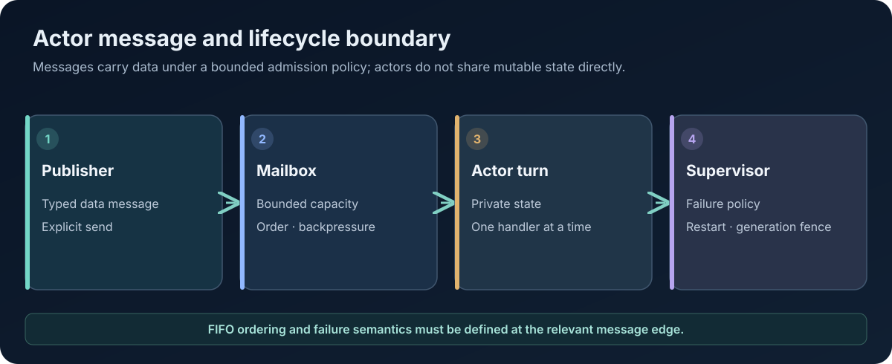

# The AttoLang Actor Runtime and Concurrency Model

**Technical Papers · Paper 04 · Version 0.2 · 8 November 2026**  
**Status:** Combines documented browser actor behavior with broader runtime design requirements. These must not be confused.

<figure class="wp-figure">
  
  <figcaption>Messages carry data, admission is bounded, and generation changes fence stale work.</figcaption>
</figure>

## Abstract

Actors provide a way to organize concurrent systems around isolated state and message-driven interaction. AttoLang's design treats actors as a first-class execution primitive rather than merely a library convention. This paper describes the actor model, the interaction between actors and tasks, message and mailbox contracts, scheduling and supervision requirements, and the current browser implementation.

The public playground demonstrates a deliberately constrained actor subset: each spawned actor runs in a dedicated Web Worker with a private WebAssembly instance, mail is handled FIFO per actor, mailboxes are bounded, and the run has a hard deadline. This is useful evidence for that environment, but it is not proof of a complete distributed actor runtime or an operating-system security boundary.

## 1. Actor fundamentals

An actor is an independently addressable unit of state and behavior. Its state is private to the actor; other actors interact with it by sending messages rather than by directly reading or mutating its fields.

A robust actor abstraction needs at least:

- A logical identity or reference.
- A state ownership boundary.
- A message type and validation rule.
- An admission and mailbox policy.
- A lifecycle and termination model.
- A failure and supervision policy.
- A resource budget.
- A definition of what happens to queued and in-flight messages.

The actor reference is a capability to communicate under the runtime's rules. It should not expose direct mutable access to the actor's memory.

## 2. Messages are data, not executable behavior

A message boundary should carry values whose ownership and transfer semantics are defined. It should not be used to smuggle arbitrary closures, methods, or lexical environments into another actor.

This restriction prevents a message from implicitly carrying references to stack frames, captured mutable variables, host objects, or executable code whose lifetime and authority are unclear. A serializable or otherwise Sendable data contract is easier to validate, persist, inspect, and transport across process or machine boundaries.

The runtime must validate payload shape and size before admitting a message. Serialization, when used, must be versioned and must fail closed on malformed data.

## 3. Mailbox ordering and backpressure

Ordering must be defined at the right scope. A useful baseline is FIFO delivery per publisher-to-subscription edge or per actor mailbox, with no promise of a global order among independent publishers unless the protocol explicitly provides one.

Unbounded queues convert overload into memory exhaustion. Mailbox capacity, graph-wide quotas, per-tenant quotas, and admission policies should therefore be explicit. A reliable publisher that cannot enqueue because a bounded queue is full should be able to suspend or receive a structured backpressure result without blocking a carrier thread or holding an actor critical section.

Cancellation during backpressure is a first-class race: the runtime must determine whether the publication was admitted, cancelled, or committed. It must never report success for a message that was not accepted.

## 4. Tasks, threads, and actors are distinct

An operating-system thread is a schedulable execution resource. A task is a unit of work that may suspend and resume. An actor is an ownership and message-processing boundary. An execution context carries the scheduling and contextual rules under which work runs.

These concepts can be composed but should not be conflated. A task may execute on different carrier threads over time. A thread may execute many tasks. An actor may own multiple tasks, subject to its turn and reentrancy contract.

The runtime design therefore needs explicit policies for task ownership, cancellation, actor-turn scheduling, carrier availability, and context propagation.

## 5. Suspension and critical sections

Synchronous functions should not suspend. Potentially suspending functions declare that effect using `suspends`. A critical section protects a non-suspending body; lock acquisition may need to wait before entering that body, but yielding while holding the protected critical section is prohibited by the design contract.

This distinction prevents a task from retaining a lock or actor turn across an arbitrary suspension. It also makes it possible to reason about fairness, deadlock, cancellation, and the maximum duration of a critical section.

The exact legality of acquisition, timeout, nested critical sections, and cancellation must be defined by the normative concurrency specification and tested across backends.

## 6. Structured concurrency

Tasks should have explicit ownership. A parent scope is responsible for its child tasks and defines whether it waits for them, cancels them, or transfers ownership under a specified operation.

Structured concurrency makes shutdown and failure propagation more tractable. It also matters to memory safety: a child task may retain borrowed or actor-owned values, so its lifetime cannot exceed the validity of those resources.

A complete implementation must test cancellation at every suspension boundary, including races where work completes at the same time cancellation arrives.

## 7. Supervision and actor lifecycle

A supervisor manages actor activation, restart policy, and failure containment. A production design should distinguish logical actor identity from one running activation. Restarting an actor creates a new activation generation and must fence stale messages or handles from reaching the replacement accidentally.

The lifecycle protocol should answer:

- When is an actor considered created, ready, terminating, and terminated?
- Does a restart preserve or reconstruct state?
- What happens to messages queued for the old activation?
- How are subscriptions restored after restart?
- How do concurrent send, close, leave, and termination operations serialize?
- Which failures restart the actor, stop the parent, or propagate to the caller?

The supervisor should not hold global locks while waiting for child actors, mailboxes, or I/O to make progress.

## 8. Browser implementation: actors in Web Workers

The public playground's guest contract documents an actual actor path. A program that declares actors exports actor initialization and receive functions and includes a type table in its Wasm custom section. The browser host starts one dedicated Web Worker per actor. Each worker instantiates its own copy of the module, so the actor's Wasm globals are private to that instance.

The documented behavior includes:

- FIFO message handling per actor with sequence numbers starting at zero.
- A maximum of 16 actors per run.
- A maximum of 10,000 messages per actor.
- Actor mail limited to the documented integer and boolean forms.
- Actors cannot spawn or send from the actor execution context in this subset.
- The main function may return before actors finish; the run drains all actor mailboxes before reporting completion.
- Output from different actors may interleave.
- An actor panic fails the run and includes the actor's name and identifier.
- A three-second run deadline terminates the runner and the actor workers it owns.

These are properties of the browser playground implementation and its current guest contract, not universal guarantees for every AttoLang runtime.

## 9. Isolation is not the same as sandboxing

A Web Worker and a private Wasm instance provide a useful state-separation boundary. They do not, by themselves, establish operating-system-level isolation. The browser still hosts the workers in the same origin and browser security model.

Likewise, a native actor heap is not equivalent to a process sandbox. A security design must separately specify capabilities, system-call exposure, file and network access, memory bounds, CPU limits, termination, and cross-tenant controls.

The runtime should grant only the host capabilities required by the guest. The browser contract's import allowlist is an example of this principle.

## 10. Conformance and adversarial tests

The actor conformance suite should cover independent state, per-actor FIFO, interleaved publishers, queue limits, invalid references, invalid payloads, actor termination during publication, close-versus-publish races, cancellation under backpressure, restart and resubscription, stale-generation fencing, and deterministic cleanup.

Tests should include both positive and negative fixtures. They should run compiled guest programs, not only host-side mocks. The same fixtures should be executed on each backend that claims the corresponding actor capability.

## Conclusion

Actors are valuable when their isolation and lifecycle semantics are explicit. A reliable AttoLang actor runtime needs bounded messaging, clear ownership, structured task lifetimes, cancellation-safe backpressure, supervision, and generation fencing. The browser playground demonstrates a useful constrained actor implementation; the broader runtime contract requires further backend-specific implementation and guest conformance evidence.

## References

- [Public compiler and actor guest contract](../play/docs/COMPILER_CONTRACT.md)
- [Playground actor example](../play/examples/actors.atto)
- [Playground source repository](https://github.com/atto-lang/atto-lang.github.io/tree/main/play)
