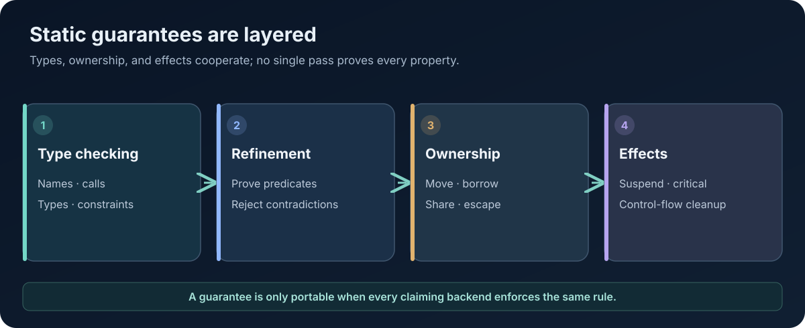

# AttoLang's Type System and Static Guarantees

**Technical Papers · Paper 06 · Version 0.2 · 8 November 2026**  
**Status:** Language-design and specification overview. It does not claim complete implementation across all compilers.

<figure class="wp-figure">
  
  <figcaption>Static guarantees must be enforced consistently by every backend that claims support. <a href="/whitepapers/assets/06-type-guarantees.svg" aria-label="Open full-size SVG diagram for paper 06">Open full-size diagram (SVG)</a></figcaption>
</figure>

## Abstract

A type system is useful not merely because it rejects malformed programs, but because it defines which facts the compiler can rely on when generating code. AttoLang's type-system direction combines explicit type forms, algebraic data types, generics, typeclasses, refinement constraints, ownership-aware checking, and a preference for compile-time resolution. It also places limits on implicit behavior: conversions, dynamic reflection, operator overloading, and automatic flattening of nested effect types are not part of the intended model.

This paper explains the design responsibilities of the type system, how static guarantees relate to ownership and AOT compilation, and the evidence needed to show that several backends agree.

## 1. Types as semantic contracts

A type describes more than storage size. It constrains which operations are valid, how values may be combined, what representation is required at an ABI boundary, and which invariants must hold before execution.

A portable type system must keep these meanings independent of the implementation language used to build the compiler. A Java implementation must not accept a program merely because Java can represent a value that another backend cannot. A native backend must not silently reinterpret a type because a machine instruction is convenient.

The canonical specification should define each type's construction, operations, equality, ownership behavior, serialization contract, and target representation where representation is observable.

## 2. Explicit type forms

AttoLang's design includes primitive types, user-defined nominal types, algebraic data types, tuples, records, structs, generic types, and refinement constraints. These forms should have distinct semantic roles.

- **Tuples** are ordered products. Position is part of their access model.
- **Records** are structural collections of named fields where field order is not the semantic identity.
- **Structs** are nominal data types whose declared identity matters.
- **Enums and algebraic data types** represent a closed set of alternatives and may carry values where the specification permits.
- **Refinement types** express predicates that further restrict a base type.

A compiler must not collapse these distinctions simply because a backend uses the same physical aggregate representation for several of them.

## 3. Algebraic data types and exhaustive reasoning

An algebraic data type makes a value's possible alternatives explicit. A sum type states that a value is one of several variants; a product type groups a known collection of values. Together, these forms let APIs express success/failure, state machines, protocol messages, and domain models without requiring sentinel values.

The design should specify whether pattern matching is exhaustive, how unreachable alternatives are diagnosed, how payload ownership works, and how generic variants are represented. A backend that lacks a direct sum-type primitive can lower a value to a tag plus payload layout, provided the representation and semantics remain conformant.

Enums currently have an important implementation boundary: the public browser compiler contract documents a restricted, payload-free enum spelling based on the LLVM design contract and explicitly notes that the Java parser does not yet accept that spelling. The existence of a documented subset must not be mistaken for universal ADT parity.

## 4. Option types and optional parameters

AttoLang distinguishes an omittable optional parameter from a parameter whose value is an Option type. These concepts are related but not interchangeable.

- A parameter of type \`T?\` may be omittable under the parameter rules.
- A parameter of type \`Option<T>\` is a required argument whose value represents an optional result.
- An Option value is not the same thing as a null pointer or an absent argument.

This separation makes call-site behavior and function contracts more explicit. The language should avoid silently inserting an Option wrapper or unwrapping one. Such conversions can change overload resolution, ownership behavior, and ABI representation.

Nested effect-bearing types also retain their structure: a \`Future<Option<T>>\` is not automatically flattened into another type, and nested futures do not disappear merely because a backend's async library has a convenience operator for flattening them.

## 5. Generics and AOT compilation

Generics provide reusable abstractions while preserving static type information. To remain compatible with an AOT-first architecture, the language should define specialization, monomorphization, dictionary passing, or other implementation strategies explicitly.

The intended policy is compile-time resolution rather than open-ended runtime specialization. Generic parameters, constraints, and named generic arguments must be resolved by the compiler, with consistent diagnostics independent of the backend.

The compiler contract must describe:
- Which generic forms are accepted.
- Whether type parameters may be inferred.
- How constraints are checked.
- Which specializations are generated.
- How recursive generic instantiations are bounded.
- How generic types are represented across ABI boundaries.
- Whether code size or compilation budgets can reject a specialization.

A generic program compiling on one target does not prove another target supports the same feature.

## 6. Typeclasses without reflection

Typeclasses express a compile-time relationship between a type and a set of operations. They can provide ad hoc polymorphism without requiring runtime reflection or mutable global registries.

An implementation may lower a typeclass-constrained call to a statically selected function or a bounded witness representation. The language must still specify coherence: whether one implementation can be selected for a given type and constraint set, how ambiguity is diagnosed, and which modules may define an implementation.

Avoiding reflection is useful for AOT because the compiler can know the callable operations and their types before execution. It also reduces dynamic lookup surfaces that can complicate sandboxing and capability control.

## 7. Refinement types and contradictions

A refinement type narrows a base type using a predicate. For example, a bounded integer type might express that a value lies within a known range. If the compiler can prove that a refinement is contradictory, it should reject the declaration or construction at compile time.

Not every predicate is decidable statically. Where a property cannot be proven from static information, the language needs a defined runtime-check mechanism, an annotation model, or a rejection rule. The design vocabulary includes Zorde runtime checks and annotations for selected runtime-validated conditions.

The crucial distinction is that a runtime refinement check is not the same thing as silently accepting a statically contradictory type. The language must identify which facts are proven, which are checked at runtime, and which remain assumptions supplied by trusted code.

## 8. Ownership is part of type checking

A type checker that ignores ownership can accept programs that are impossible to compile safely under a static lifetime model. The type system therefore needs to coordinate with ownership analysis for moves, borrows, shared values, actor messages, and resource handles.

Ownership qualifiers such as \`rt borrow\`, \`rt share\`, \`rt take\`, and \`rt copy\` are intended to make resource-flow operations explicit. The exact legal uses must be specified per type category and per context. A type may be copyable, movable, borrowable, or shareable only under defined rules.

Borrow validity across suspension points is especially important. A task may resume on a different carrier thread, and the resource it borrowed may have a shorter lifetime than the suspended task. The compiler must either prove that the borrow remains valid or reject the program.

## 9. No implicit conversions and no operator overloading

Implicit conversions can produce backend-dependent results when precision, width, signedness, or representation differ. AttoLang's design rejects implicit conversions rather than asking programmers to infer whether a conversion is lossless.

Likewise, built-in operators should retain one well-defined meaning. Operator overloading can make arithmetic syntax execute arbitrary user code, complicating effect checking, optimization, and security review. The language's negative fixtures should reject removed operators and unsupported overloads consistently.

Evaluation order is also a type-system-adjacent semantic obligation. An optimizer cannot assume boolean expressions are short-circuiting if the contract specifies eager, left-to-right evaluation in the relevant condition form.

## 10. Static guarantees and target representation

The type system is one of the foundations for portable layout and ABI design. It can help prove field offsets, calling conventions, generic specialization, and safe conversion of values at foreign-function boundaries.

However, a static type guarantee is only meaningful if every compiler backend preserves it. The conformance corpus should test accepted and rejected programs, overload ambiguity, refinement contradictions, generic specialization, Option/Future nesting, ownership errors, and serialization boundaries on each target.

## 11. Current status and proof obligations

The public browser compiler implements a limited type subset and explicitly rejects many language constructs, including strings as general values, floats, imports, lambdas, Option/Result, generic classes, and other features. Its documented enum support is partial relative to the broader language parser story. This paper describes the intended type-system architecture, not a claim that all listed type forms are implemented on every target.

Before claiming a static guarantee is implemented, publish the normative rule, positive and negative fixtures, compiler source references, and guest-level execution or rejection evidence for each backend.

## Conclusion

AttoLang's type system should make values, effects, ownership, and representations explicit enough for compilers to reason about programs before execution. Its success depends on precise contracts and consistent enforcement, not on the number of type constructs in the grammar.

## References

- [Public playground compiler contract](../play/docs/COMPILER_CONTRACT.md)
- [Canonical AttoLang specification repository](https://github.com/atto-lang/atto-spec)
- [Public compiler implementation](https://github.com/atto-lang/atto-source.rs)
