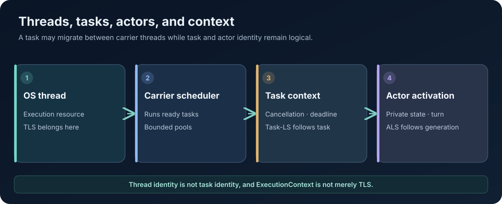

# ExecutionContext: Threads, Tasks, and Scheduling in AttoLang

**Technical Papers · Paper 07 · Version 0.2 · 8 November 2026**  
**Status:** Runtime architecture paper. The scheduling model is a design target; do not infer complete implementation from the existence of an ExecutionContext API or host scheduler.

<figure class="wp-figure">
  
  <figcaption>Thread identity, task identity, actor identity, and execution policy are separate dimensions. <a href="/whitepapers/assets/07-execution-context.svg" aria-label="Open full-size SVG diagram for paper 07">Open full-size diagram (SVG)</a></figcaption>
</figure>

## Abstract

Concurrent programs need a precise answer to three questions: what is being scheduled, where it may execute, and which contextual state follows it. AttoLang treats operating-system threads, coroutine tasks, actors, and execution contexts as distinct concepts. This separation supports explicit suspension, structured task lifetimes, actor ownership, and runtime policies that can evolve independently of a particular host language.

This paper describes the intended ExecutionContext model, carrier scheduling, task and thread-local state, cancellation, and the evidence needed to validate fairness and resource behavior.

## 1. Four different concepts

An **operating-system thread** is a host-scheduled execution resource. A **task** is a unit of work that may suspend and resume without monopolizing a thread. An **actor** owns state and processes messages under an actor-turn contract. An **ExecutionContext** carries the runtime policy and contextual information under which work executes.

These concepts compose. A task can move between carrier threads. A thread can run many tasks. An actor can own asynchronous tasks while constraining access to its mutable state. An ExecutionContext can influence scheduling and resource policy without being identical to the carrier thread.

Treating an ExecutionContext as merely a thread-local map is insufficient because tasks can suspend and resume on different threads.

## 2. The purpose of ExecutionContext

An ExecutionContext should make execution policy explicit. Depending on the runtime, it can include scheduler selection, cancellation scope, deadline, tracing context, tenant identity, resource accounting, task-local bindings, and permitted runtime capabilities.

The exact fields should be versioned and documented rather than treated as an unstructured bag of mutable values. Context propagation must define which fields are inherited, copied, overridden, reset, or deliberately not propagated when a task is spawned or work crosses an actor boundary.

A context is not a substitute for ownership. Carrying a tenant identifier does not authorize a task to access tenant memory; a capability and isolation check still need to enforce that boundary.

## 3. Tasks are coroutines, threads are not

The design distinguishes coroutine tasks from pthread-style operating-system threads. A task can suspend at an allowed suspension point and later resume. A thread has an independently scheduled stack and lifecycle and should expose an API that does not depend on Java's thread implementation details.

This distinction helps portable runtimes because each backend can provide a host-specific carrier while retaining a common task contract. A Java implementation may use JVM facilities; an LLVM runtime may use native threads and event notification; a .NET implementation may use platform threading primitives; a Wasm implementation may have a more restricted execution environment.

The language contract should avoid promising identical thread capabilities where the target platform cannot provide them. It should instead define which parts of the abstract API are supported, unsupported, or emulated on each target.

## 4. Scheduler pools and admission

A scheduler can separate work by trust and urgency. The current architectural vocabulary includes CONTROL, SHARED, PRIVATE, and UNTRUSTED pools.

- **CONTROL** work protects runtime progress: cancellation, shutdown, timer delivery, and other control-plane operations.
- **SHARED** work uses a common bounded execution resource.
- **PRIVATE** work receives a more isolated execution allocation where policy requires it.
- **UNTRUSTED** work runs under tighter quotas and interruption/cancellation policy.

These categories are policy concepts. The scheduler must still define thread counts, queue bounds, priority, fairness, starvation prevention, tenant accounting, and behavior under exhaustion. A pool name alone is not a guarantee of isolation.

Admission should be explicit. A system under resource pressure should reject or defer new work predictably rather than allocate unbounded tasks or consume all capacity needed to stop existing work.

## 5. Carrier threads and suspension

A carrier thread executes a task until it reaches a suspension point or completes. When a task waits for I/O, a channel operation, a timer, or another asynchronous event, the runtime should park the task continuation and release the carrier to execute other eligible work.

A carrier must not block while waiting for an operation that the same scheduler needs to complete. This is particularly important for bounded mailboxes and reliable publication: waiting for capacity must suspend the task, not hold a carrier or an actor critical section.

A task's stack or continuation representation must remain valid across suspension. If the runtime uses segmented stacks, heap-allocated frames, or compiler-generated state machines, the ABI and ownership rules must specify how references remain valid while suspended.

## 6. Thread-local, task-local, and actor-local storage

Three kinds of contextual storage solve different problems:

- **Thread-local storage (TLS)** belongs to one operating-system thread. It is appropriate for native thread-specific state and must not be mistaken for task identity.
- **Task-local storage (Task-LS)** follows one logical task across suspension and carrier migration.
- **Actor-local storage (ALS)** belongs to an actor activation or generation and must be isolated from other actors.

A runtime may also need request-local or tenant-local context, but these should have explicit ownership and propagation semantics. Context should not leak accidentally when a carrier thread runs a task from another tenant or actor.

Tests must verify that values remain attached to the correct logical owner when tasks are suspended, resumed on another carrier, cancelled, restarted, or migrated between execution pools.

## 7. Actor turns and reentrancy

Actor state is safest when one handler owns the actor turn while it processes a message. The design baseline is that handlers do not become reentrant across suspension. If a handler suspends, the runtime must define whether the actor turn remains logically owned, whether other messages may be processed, and which state can be observed or mutated.

Holding a synchronous critical section across suspension is a separate and more restrictive error. The runtime should distinguish mutex ownership, actor-turn ownership, and task suspension rather than modeling all three with one lock.

## 8. Timers and deadlines

Timers should be represented as actor- or task-owned logical state serviced by a runtime timer facility. The timer service should not execute arbitrary guest closures. Instead, it should enqueue a bounded control event or resume a continuation that the scheduler already owns.

Deadlines should be propagated through structured task scopes. A timeout must have a defined outcome: cancellation request, cancellation completion, timeout error, or resource-specific timeout. The system should distinguish queue wait, channel wait, execution, and total operation deadlines where those dimensions are part of the API.

## 9. Locality and fairness

Resuming work on the same CPU core may improve cache locality, but strict affinity can reduce load balancing and resilience. The scheduler should treat locality as a policy hint, not a universal correctness rule. Work stealing, pinned tasks, actor affinity, and migration need explicit interactions.

Fairness must be evaluated under contention, not inferred from a FIFO queue in one code path. A complete test plan should include multiple producers, priority inversion, queue saturation, cancellation floods, timer storms, and tasks that repeatedly suspend and resume.

## 10. Portability boundaries

The abstract task contract can be shared even where target scheduling primitives differ. Native backends may offer multiple carrier pools and OS threads; browser Wasm may use workers and event-loop integration; managed runtimes may expose different interruption and affinity capabilities.

A capability report should state which features are native, emulated, limited, or unsupported. The compiler must reject source programs that require an unavailable capability unless the language contract explicitly defines a fallback with equivalent semantics.

## 11. Current status and conformance requirements

ExecutionContext is part of the broader AttoLang runtime architecture. This paper does not claim that all scheduler pools, TLS/Task-LS/ALS, task migration, timer accounting, or native thread APIs are implemented consistently across every backend.

Tests should record task identity, thread identity, actor generation, tenant identity, scheduler pool, and suspension/resume transitions. They should validate non-blocking waits, bounded queues, cleanup on cancellation, no context leakage, fair admission, and recovery after carrier loss where supported.

## Conclusion

ExecutionContext is most useful when it describes the logical work being performed, not merely the thread currently running it. By separating threads, tasks, actors, and contextual policy, AttoLang can provide a portable concurrency contract while allowing each backend to use appropriate host scheduling primitives.

## References

- [AttoLang specification repository](https://github.com/atto-lang/atto-spec)
- [AttoLang compiler and runtime repositories](https://github.com/atto-lang)
- [Public playground guest execution contract](../play/docs/COMPILER_CONTRACT.md)
