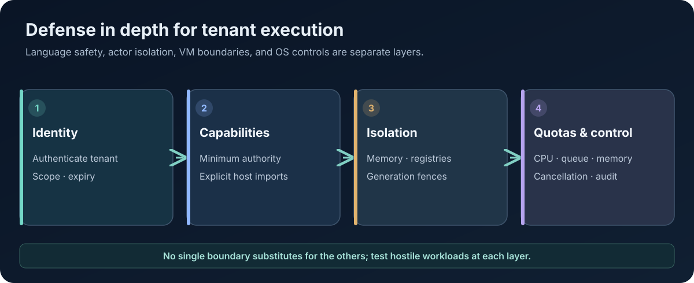

# Multi-Tenant Isolation and Security in AttoLang

**Technical Papers · Paper 09 · Version 0.2 · 8 November 2026**  
**Status:** Security architecture paper. It describes target controls and does not certify a complete production sandbox.

<figure class="wp-figure">
  
  <figcaption>Security requires enforcement at every resource boundary, not merely language-level visibility. <a href="/whitepapers/assets/09-tenant-security.svg" aria-label="Open full-size SVG diagram for paper 09">Open full-size diagram (SVG)</a></figcaption>
</figure>

## Abstract

Running several tenants in one runtime creates shared failure domains. A tenant may consume CPU, memory, queue capacity, file descriptors, network resources, or scheduler attention needed by others. Correct isolation therefore requires more than separate actor names or language-level visibility. It requires explicit identity, capabilities, resource accounting, scheduling policy, memory separation, generation fencing, and adversarial tests.

This paper describes the isolation layers relevant to AttoLang and explains why language safety, actor isolation, virtual-machine isolation, and operating-system sandboxing are separate guarantees.

## 1. Threat model

A multi-tenant runtime should assume that tenant code may be buggy, resource-hungry, stale, or actively adversarial. It may attempt to access another tenant's state, exhaust shared queues, retain resources indefinitely, forge identifiers, exploit callback timing, or continue work after cancellation.

The design should state which adversaries are in scope. An untrusted guest executing with restricted capabilities is different from a compromised host kernel or a malicious administrator. Security claims are meaningful only when the protected assets, trust assumptions, and attacker capabilities are explicit.

## 2. Isolation layers

Several boundaries contribute to security, but none should be confused with another.

- **Type and ownership safety** constrain invalid program operations.
- **Actor isolation** protects actor-owned mutable state from direct access by other actors.
- **Tenant runtime isolation** separates tenant registries, memory accounting, scheduler admission, and queues.
- **Wasm or VM isolation** constrains guest memory and host imports according to a runtime's module model.
- **Operating-system isolation** constrains process authority, files, networks, syscalls, and resource consumption.

A memory-safe language can still run a program with excessive authority. An actor can still share a process with other actors. A Wasm module can still consume too much CPU if the host does not enforce deadlines and fuel or interruption policy.

## 3. Identity and namespace boundaries

Every tenant-scoped operation should carry an authenticated tenant identity and a namespace-qualified resource key. A durable actor identity can be represented as tenant, namespace, and object identifier. The runtime should not accept a caller-supplied tenant string as proof of authority.

Identity should be bound to a verified credential or capability. Checks should include audience, scope, expiry, revocation, and generation where appropriate. The authorization result should be enforced at the resource boundary, not only in a high-level router.

## 4. Capability-based host access

A guest should receive only the host capabilities it needs. File access, network access, timers, process control, environment variables, and host object references should be separately granted. The ABI should not expose a generic escape hatch that lets the guest call arbitrary host functions.

Capability identifiers should be unforgeable in the relevant threat model and scoped to a tenant, actor, and generation as appropriate. Revocation must be checked during long-lived operations, not only when a capability is first created.

The browser playground demonstrates a narrow import allowlist for a restricted guest module. That is a concrete example of limiting host authority, but it is not equivalent to a full native multi-tenant sandbox.

## 5. Memory and runtime isolation

A tenant runtime should own separate actor registries, heaps or allocation domains, activation maps, and accounting records. A tenant-specific heap is useful only if references cannot cross into another tenant without an explicit transfer protocol.

Native runtimes may use process isolation, virtual-memory regions, or allocator domains depending on the threat model. Wasm runtimes provide linear-memory isolation between modules, but imported host functions remain privileged boundaries. Managed runtimes may need additional fences around host objects, classloaders, and native handles.

Memory ownership rules should prohibit stale references from surviving tenant or actor reclamation. Generation fencing protects against a delayed operation reaching a resource that has been destroyed and re-created under the same logical name.

## 6. CPU, queue, and resource quotas

A tenant can cause denial of service without violating memory safety. Each tenant should have bounded budgets for:
- Active tasks and actor activations.
- CPU time or execution fuel.
- Mailbox and channel capacity.
- Total graph queue capacity.
- Memory and allocation rate.
- Timers and scheduled callbacks.
- Open handles and network connections.
- Concurrent compilation and artifact size.

Queue admission should be bounded and fair. One tenant's full mailbox must not consume capacity reserved for CONTROL operations needed to cancel or shut down the workload.

Quota exhaustion should produce a stable result and must not leave partially admitted tasks or messages. Quotas should be enforced where resources are actually consumed, not only at API entry.

## 7. Scheduler and interruption policy

Trusted runtime control work should remain able to make progress when untrusted work saturates its budget. Separate CONTROL and UNTRUSTED scheduling classes can help, but the scheduler must prove this with contention tests.

Cancellation and interruption need bounded response times. A cooperative guest can check cancellation at safe points; a tight loop that never yields may require runtime interruption, fuel limits, or process termination. Each target must document what mechanism is used and what maximum delay is expected.

A timeout that merely stops waiting in the caller while guest computation continues is not an effective execution limit.

## 8. Channels and pub-sub boundaries

Messages between tenants or actors should contain data values with defined transfer or serialization semantics. Arbitrary functions, methods, closures, and lexical environments should not cross channels or pub-sub boundaries.

The receiving side should validate payload type, size, schema version, and authorization. Cross-tenant communication should be an explicit capability-mediated operation with accounting and audit events. Broadcast operations must respect per-edge and graph-wide quotas and support cancellation while backpressured.

## 9. Secrets and operational security

Secrets should not be embedded in guest artifacts or compiler outputs. The host should provide scoped secret capabilities with explicit rotation and revocation. Logs and traces must avoid recording secret values and should include tenant and generation identifiers without exposing cross-tenant information.

Artifact distribution should bind the artifact to its digest, compiler revision, and signature or approved provenance. A digest proves byte identity; it does not establish that the artifact is safe or authorized.

## 10. Cross-target security equivalence

Different backends have different isolation primitives. A browser worker, Wasmtime instance, JVM process, .NET process, and native process do not automatically provide equivalent security boundaries.

The platform contract should identify capabilities by category and describe each target's enforcement mechanism. If one target cannot provide an equivalent guarantee, the feature should be marked unsupported or weaker rather than silently treated as conformant.

Security parity requires adversarial guest tests, not only unit tests of policy helper functions.

## 11. Security verification matrix

A useful test suite includes forged tenant IDs, stale credentials, revoked capabilities, cross-tenant handle use, use-after-generation, invalid message payloads, mailbox flooding, CPU exhaustion, cancellation starvation, quota races, actor restart during publication, and attempts to invoke ungranted host imports.

Tests should record whether they ran as host tests, Wasm guest execution, native guest execution, or production validation. The evidence must identify exact source heads and the effective runtime configuration.

## 12. Current status and limitations

AttoLang's broader architecture includes tenant-qualified actor identity, isolated VM and memory domains, bounded per-tenant queues, generation-fenced tickets, and separate trusted/untrusted scheduling concepts. This paper describes the security model and required proof points; it does not certify that every boundary has been implemented and adversarially validated on every backend.

The public browser playground is a constrained static guest environment with an import allowlist, bounded output, memory limits, actor limits, and a run deadline. The contract explicitly cautions that a browser worker is not OS-level isolation. See the [playground compiler contract](../play/docs/COMPILER_CONTRACT.md).

## Conclusion

Multi-tenant isolation is an end-to-end system property. Language rules, actor ownership, VM boundaries, capabilities, quotas, schedulers, and operational controls must reinforce one another. A trustworthy platform states its limits and proves each enforcement boundary against an adversarial workload.

## References

- [Public playground compiler contract](../play/docs/COMPILER_CONTRACT.md)
- [AttoLang platform conformance](https://github.com/atto-lang/atto-platform-conformance)
- [AttoLang organization](https://github.com/atto-lang)
