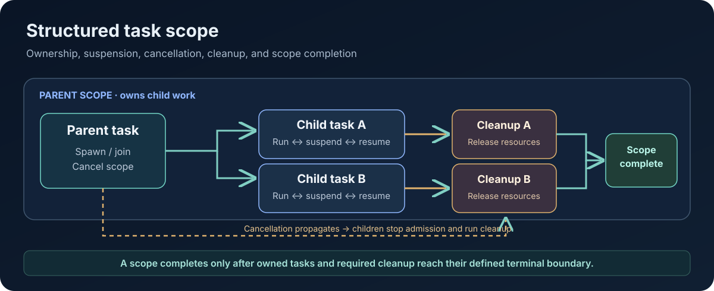

# Async Programming and Structured Concurrency in AttoLang

**Technical Papers · Paper 11 · Version 0.3 · 10 November 2026**  
**Status:** Concurrency design and conformance paper. It documents intended contracts and proof obligations; it does not claim complete implementation parity across all AttoLang backends.

<figure class="wp-figure">
  
  <figcaption>A structured task scope gives child work a clear owner and completion boundary. Cancellation is a request to stop; scope completion requires owned work and resources to reach a defined terminal state.</figcaption>
</figure>

## Abstract

Asynchronous programming is not merely a way to avoid blocking threads. It changes the lifetime of computations, the validity of references, the ownership of resources, and the meaning of failure. A task can suspend, resume later, move between carrier threads, and retain state while external events remain pending. Without explicit lifecycle rules, cancellation can leave locks held, timers armed, subscriptions registered, or child tasks running after their caller has returned.

AttoLang's concurrency direction treats tasks as composable values and structured scopes as ownership boundaries. This paper defines the design goals for task creation, suspension, cancellation, cleanup, deadlines, and continuation tracing. It distinguishes language-level contracts from scheduler implementation and presents the conformance evidence needed before a backend can claim support.

## 1. Tasks are computations with lifetimes

A task represents a unit of work whose execution may be suspended and resumed. It is distinct from an operating-system thread, which is a scheduling resource, and from an actor, which is an ownership and message-processing boundary.

A task needs a stable logical identity even when its continuation resumes on another carrier. Its lifecycle should be observable through states such as created, scheduled, running, suspended, cancellation-requested, completing, completed, failed, and cancelled. The exact state machine must avoid ambiguous transitions—for example, a task must not simultaneously be reported as successfully completed and cancelled.

A task handle should expose only operations permitted by the task's ownership and capability contract. A handle to a child task must not silently become authority to detach it from its parent scope.

## 2. Structured concurrency defines ownership

Structured concurrency makes the lexical or dynamic task scope responsible for the work it starts. A parent scope owns its child tasks and cannot complete while children remain unaccounted for. The scope defines what happens when the parent returns normally, fails, or is cancelled.

The default structured rule should be:

1. Child tasks belong to the scope that created them.
2. The scope joins children before normal completion.
3. A child failure is observed by the scope according to an explicit aggregation policy.
4. Parent cancellation propagates to children.
5. Scope exit waits for cancellation and cleanup to reach the specified terminal boundary.
6. Detachment or ownership transfer is explicit, reviewed, and bounded.

This model prevents abandoned background work from retaining resources or outliving the state it references. It also gives a natural place to apply deadlines, tracing, quotas, and cancellation policy.

## 3. Composition should preserve outcomes

Task composition should behave like composition of typed computations, not like an opaque thread-spawning side effect. Joining two tasks, racing alternatives, collecting results, and selecting over channels should preserve the type and failure information of each operation.

The API should distinguish at least:

- **Join:** wait for a task and observe its result.
- **Join-all:** wait for a known group and collect all outcomes.
- **Race/select:** choose one completion under a defined winner and loser-cancellation rule.
- **Try-join:** return success or a typed failure without losing the original error.
- **Spawn:** create child work under the current scope.
- **Transfer:** explicitly move task ownership where the language contract allows it.

Automatic flattening of nested asynchronous result types should not hide type structure. A value such as `Future<Option<T>>` should retain its declared layers unless an explicit combinator transforms it.

A composition operator must specify what happens to remaining tasks when one branch wins or fails. It is not sufficient to return the first result while leaving losing branches running indefinitely.

## 4. Suspension is an explicit effect

AttoLang distinguishes functions that are guaranteed not to suspend from functions that may suspend. The design uses `suspends` to expose this effect in declarations and call checking.

This distinction matters to callers and to the compiler. A synchronous function can be used in contexts that cannot yield. A suspending function requires an execution context capable of parking and resuming the current task. The compiler should reject a suspending call from a context whose contract forbids suspension.

Critical sections and non-reentrant actor turns are separate constraints. A task must not yield while holding a synchronous critical section. An actor handler must also obey the actor-turn contract across suspension; allowing another handler to mutate the same actor state while the first handler is suspended would introduce reentrancy and invalidate simple ownership reasoning.

## 5. Cancellation is a protocol, not a kill switch

Cancellation should be cooperative at language-defined safe points, with stronger runtime enforcement for untrusted or non-cooperative guest execution. A cancellation request changes the task's state and propagates through owned child scopes. It does not mean the task has already stopped.

A safe cancellation protocol has several stages:

1. Record the cancellation reason and request time.
2. Stop admitting new child work into the cancelled scope.
3. Notify owned child tasks and cancellation-aware operations.
4. Resume or unwind suspended continuations as required to run cleanup.
5. Release locks, subscriptions, timers, handles, and other owned resources.
6. Confirm that child tasks and external operations have reached an acknowledged terminal state.
7. Mark the scope complete only after the required cleanup boundary is satisfied.

Cancellation races with normal completion, timeout, I/O readiness, and task failure. The runtime must define which outcome wins and make the outcome observable. It must not report cancellation completion merely because the caller stopped waiting.

## 6. Cleanup must survive every exit path

Resource acquisition should be paired with cleanup that runs on normal return, error, panic, cancellation, and early exit. Cleanup order should follow ownership nesting: resources acquired later are generally released before resources acquired earlier, unless a type-specific contract defines a different dependency order.

Cleanup itself should be bounded and should not unexpectedly suspend while holding a critical section. Where asynchronous close is required, it should be represented as an explicit suspending cleanup phase with a deadline and a defined failure policy.

Locks need special attention. A task cancelled while waiting to acquire a lock must be removed from the wait queue. A task cancelled after acquiring a lock must release it before cancellation is considered complete. Reader-writer locks must not admit a writer and readers concurrently, and the fairness policy must prevent starvation within the documented scheduling model.

An actor or supervisor that owns a task must not reclaim the associated memory region while the task or one of its cleanup operations can still access it. Cancellation, actor STOP, restart, and reclamation therefore share a quiescence contract.

## 7. Deadlines and timers compose with tasks

A deadline should be attached to a task scope and inherited by child tasks unless an explicit, bounded override is permitted. A child must not accidentally extend the parent's total deadline merely by creating another timer.

The runtime should distinguish the total operation deadline from a resource-specific timeout, queue-admission wait, lock-acquisition wait, and I/O timeout. These may produce different typed outcomes even if they share one underlying timer service.

Timer delivery should enqueue a bounded control event or resume a runtime-owned continuation. A timer service should not execute arbitrary guest closures. When a task completes or is cancelled, its timer registration must be disarmed or made harmless through generation checks.

A hard real-time guarantee cannot be inferred from the existence of timers or deadlines. It requires bounded scheduling latency, interruptibility, resource admission, and a measured execution environment with a stated worst-case model.

## 8. Continuation tracing and context propagation

An async operation may cross many continuations before producing a result. Tracing should preserve a logical task and trace identity across suspension, wake-up, carrier migration, and child-task creation.

The context model must distinguish thread-local storage from task-local and actor-local storage. Thread-local values belong to the current OS thread and should not be used as a portable task identity. Task-local values follow the logical task across suspension; actor-local values follow an actor activation or generation. Context propagation should define which fields are inherited, copied, cleared, or forbidden across tenant and actor boundaries.

Trace events should make parent-child task relationships, suspension reasons, wake-up causes, cancellation propagation, cleanup duration, and terminal outcomes visible without logging sensitive payload data.

## 9. Scheduler interaction and fairness

The task API should remain independent of one backend's scheduler implementation. Java/GraalVM, LLVM, .NET NativeAOT, Wasm, and Forge/Cranelift may use different carrier mechanisms, but each backend that claims the task contract must preserve task identity, outcome semantics, bounded admission, cancellation, and cleanup behavior.

Fairness must be specified and tested under contention. A FIFO lock queue in isolation does not prove scheduler-wide fairness. The test suite should include saturated mailboxes, repeated wake-ups, timer storms, cancellation floods, long-running cooperative loops, carrier exhaustion, and tasks that repeatedly suspend and resume.

Untrusted tasks may require fuel, CPU quotas, isolation, or host-enforced interruption. Cooperative cancellation alone is insufficient when guest code can execute indefinitely without reaching a checkpoint.

## 10. Failure semantics and supervision

A task failure should remain associated with the scope that owns it. The language should define whether sibling tasks are cancelled immediately, whether all sibling failures are collected, and how cancellation failures are represented alongside the original error.

Actor supervision adds another ownership boundary. If an actor owns tasks, terminating or restarting the actor must stop admission to the old activation, cancel or drain its tasks, resolve their resources, fence stale continuations, and only then reclaim activation-scoped state. A task must not resume into a replacement actor generation with authority over old memory.

## 11. Backend conformance matrix

Every backend claiming structured task support should execute the same semantic fixtures. The matrix should report each dimension separately:

| Dimension | Required guest-level proof |
|---|---|
| Parent/child ownership | Child is joined or explicitly transferred before scope exit |
| Completion | Parent cannot report complete while an owned child remains active |
| Failure propagation | Child error reaches the owning scope with its identity preserved |
| Cancellation | Parent cancellation reaches children and resolves the documented race |
| Cleanup | Locks, timers, subscriptions, and resources are released on each exit path |
| Deadlines | Expired scopes stop admission and reach a bounded terminal outcome |
| Migration | Task-local context follows the task when carrier identity changes |
| Actor lifecycle | Old-generation tasks cannot access replacement actor state |
| Fairness | Contended waiters make progress within the documented policy |
| Observability | Parent/child and continuation trace relationships remain intact |

Host tests are valuable for scheduler helpers and resource managers, but they do not prove that compiled guest programs obey the contract. A backend conformance claim requires exact-head guest execution with non-zero executed steps and a receipt identifying compiler, runtime, target, fixtures, and toolchain.

## 12. Current status and limitations

This paper records AttoLang's intended task model and the tests needed to validate it. It does not claim that all task APIs, structured scopes, cancellation cleanup, task-local storage, deadlines, continuation tracing, or fairness guarantees are implemented consistently across all five backend families.

The public browser playground is a constrained execution subset and should not be treated as proof of the complete native task runtime. Backend status belongs in a versioned conformance report with exact source identities and actual guest-test receipts.

## Conclusion

Asynchronous programming becomes safer when a task has an owner, suspension is explicit, cancellation is observable, and cleanup is part of completion. Structured concurrency provides the lifecycle boundary; ownership and effect checking constrain what may cross it; runtime scheduling and conformance tests demonstrate whether each backend preserves the contract.

## References

- [AttoLang specification repository](https://github.com/atto-lang/atto-spec)
- [AttoLang platform conformance repository](https://github.com/atto-lang/atto-platform-conformance)
- [ExecutionContext and scheduling paper](07-execution-context-and-scheduling.html)
- [Actor runtime and concurrency paper](04-actor-runtime-and-concurrency.html)
- [Public playground compiler contract](../play/docs/COMPILER_CONTRACT.md)
